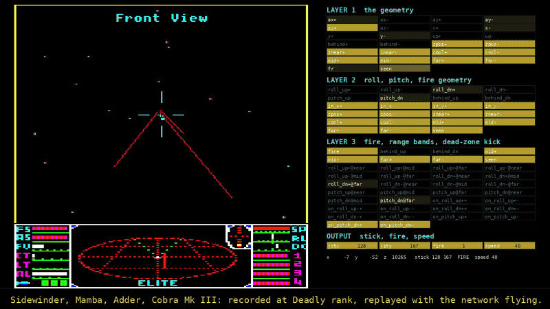
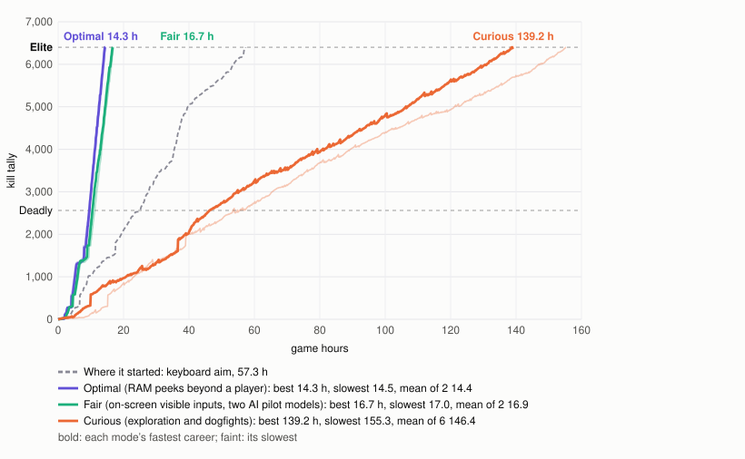
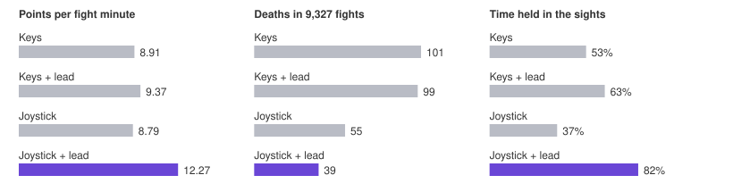

# Elite agent

## ▶ [Watch it fly live in your browser](https://8bitkick.cc/elite-agent/)

[](https://8bitkick.cc/elite-agent/)

A player for Acornsoft Elite (BBC Master, Mark Moxon's flicker-free build), written in pure C. It reads
the machine's RAM and plays only through the keyboard and the analogue joystick (Elite's own joystick
option). It's self-contained: no OS, no heap, no network, no ML library, about 100 KB of code
and under 30 KB of RAM compiled for the RP2350's Cortex-M33. It runs on that microcontroller, a Pimoroni
Presto, beside the BBC Master emulator, averaging about 2.4 ms of each 20 ms frame; the same code runs on a native
build of the emulator (Pi or Mac) for development.

It's also released as a plugin for [rp2350-bbc-micro](https://github.com/8bitkick/rp2350-bbc-micro)'s
plugin slot: `elite-agent.bin` on the [releases page](https://github.com/8bitkick/elite-agent/releases).

Fair mode's dogfights and dockings are flown by two small neural networks whose weights an AI wrote directly, unit
by unit, then tuned by evolution; a plain C forward pass runs each. The dogfight network (8 KB) scores 97% of the
C rules' points a fight minute over 450 held-out fights, every fight its own; the docking network (1.5 KB) flies
from the hyperspace exit to docked and docks 2.8% cheaper than the C law it replaced, over 69 held-out dockings,
with a sixth of its stick reversals. After MIT CSAIL's
[Sparks of Weight-Space Programming](https://rikiyat.github.io/blog/weight-space-programming/) (2 Nov 2026); how they
were written and measured: [wsp/README.md](wsp/README.md).

**[The live page](https://8bitkick.cc/elite-agent/)**: the same C player, compiled to WebAssembly, flies Fair mode
on the BBC Master of [jsbeeb](https://github.com/mattgodbolt/jsbeeb), Matt Godbolt's BBC Micro emulator for the browser (thank you, Matt), from Jameson to Elite, beside the film's panel with
both networks' units lit as they decide. ▶ 1×, Auto (real time in fights and the docking's final, turbo between) or
▶▶ Turbo; jump to Deadly; save the commander as an .ssd to load in your own Elite. Elite itself is Mark Moxon's
flicker-free disc, fetched by the browser from his GitHub repository ([web/README.md](web/README.md)). The
page's career is the same for every visitor (its start is taken at an instruction boundary, so it doesn't depend on
the visitor's computer); `?game=solid` plays Eben Upton's Solid Elite and `?start=N` picks another start. The careers
from the new starts are being flown headless to Elite (the previous start's reached it in 18.9 game hours).
[web/STARTS.md](web/STARTS.md) has the results so far, and how to test a start and log it.

**Trading:** why the agent's earlier "sloppy" trading (thin margins, selling and buying straight back) reached Elite
sooner than a tidier rewrite, with the money traced through 16 careers, and what would beat both:
[docs/TRADING.md](docs/TRADING.md).

## Modes

| Mode | What it does | Switch | Jameson to Elite |
|---|---|---|---|
| **Optimal**<br>RAM peeks beyond human player knowledge | straight for Elite, farming Thargoids in witchspace ([below](#where-the-time-goes)); reads any RAM it needs, even bytes the screen never shows, like an enemy's energy ([`docs/IO.md`](docs/IO.md)) | **the default** in run_sim, the lab and the firmware build; `--efficient` for the Presto plugin | **14.3 game hours** (the best of two careers) |
| **Fair**<br>only uses what a player can view or derive from the screen | Optimal's career on what a player could see: the screen, scanner and dashboard as drawn, the game's rules, its own notes; no hidden RAM ([`docs/FAIR.md`](docs/FAIR.md)). Its dogfights and its dockings are flown by two AI pilot models, 8 KB and 1.5 KB ([`wsp/README.md`](wsp/README.md); `WSP=0` and `WSPAPP=0` for the C rules they replaced) | `FAIR=1`; `--fair` on the Presto | **16.7 game hours** (the best of two careers) |
| **Curious**<br>maximum fun, exploration and dogfights | explores every galaxy, meets every ship type, both missions; more stylish piloting: enemies close and big on screen, flybys watched from the side, strafing runs, Thargoid swarms, losses up to 5% accepted ([`docs/FIGHTING.md`](docs/FIGHTING.md)) | `CURIOUS=1`; **the default** for the Presto plugin | not tuned for time, but for style: **139.2 game hours** (the best of six careers, on v0.4) |

All modes save at each dock (about 4 seconds; on the Presto Curious runs the save in turbo), so a death loses only the trip since. Times are game
hours on the native emulator at the real machine's speed.



**Careers in numbers**, Jameson to Elite: each mode's best career (`tools/career_stats.py` on the journals in
[`docs/careers`](docs/careers)):

| | Optimal | Fair |
|---|---|---|
| Game hours to Elite | 14.3 | 16.7 |
| Star systems visited | 63 | 66 |
| Galaxies | 3 | 3 |
| Light years flown (dock to dock) | 504 | 537 |
| Docks | 188 | 200 |
| Fights | 1,219 | 1,562 |
| Kills | 4,653 | 4,788 |
| Witchspace sessions (Thargoids) | 64 | 76 |
| Deaths (reloaded) | 0 | 1 |
| Escape pods used | 0 | 0 |
| Most credits held | 26,264 Cr | 22,675 Cr |

Fair counts more fights because a dot at the edge of range can turn out to be a trader once it's
drawn, ending a fight that hadn't started.

Curious mode's fights get more stylish piloting, tuned on how big the enemy is on screen and for how long: a ship
drawn 64 to 160 pixels counts a whole second, less as it gets smaller or too big to fit (`tools/show.py`'s BIG SHIPS).
Its steering in a fight is a camera operator's (`cplayer/cfly.c`): with the enemy in the picture the pitch eases on
and off and never flips for a small error, a roll is one deliberate move when the ship is out to the side, and a
speck far off is flown in a few big moves rather than re-aimed every frame; out of the picture it comes round as fast
as it can. Specks that are getting away are shot rather than chased. Optimal kills from as far out as it can.

## Where the time goes

**Optimal's strategy is farming Thargoids.** Elite has a hidden manual mis-jump: with the author credits switched on
(X in the pause menu), holding CTRL as the hyperspace countdown ends drops the ship into witchspace among a swarm of
Thargoids, the best-paying fight in the game (Moxon's annotated source,
[TT18](https://elite.bbcelite.com/master/main/subroutine/tt18.html); [`docs/IO.md`](docs/IO.md) §1.6). With the swarm cleared and
its shields back, it jumps again from witchspace, which mis-jumps again, and keeps going while the fuel covers another
jump and a way out to a station. How many jumps it can string together depends on the map round its starting
system, so it picks where to farm from a model of every system in the galaxy.

In its best career (14.3 game hours), witchspace was 53% of the time and 88% of the points, about 12 points a game
minute; bounty hunting at anarchies scores an eighth of that. The rest of the time is travel, docking, shopping and
the two missions. It reached Competent in 2.3 hours, Deadly in 9.6 and Elite in 14.3.

**Why it's fast:**

- **Aim.** The joystick put at an exact position each frame, aiming 4.5 game loops ahead, and each
  new target reached in one planned roll-and-pitch motion simulated from Elite's own rotation maths.
  Over 9,327 recorded fights: 38% more points a fight minute than the keyboard, 39 deaths instead
  of 101, the target in the sights 82% of the time.
- **Thargoids.** Witchspace fights score about 30 points a fight minute, normal space about 12.
- **Cheap deaths.** With a save at every dock it can take risks a no-save player can't.
- **Docking.** A smooth line-up at full speed: about 17 s a dock faster than v0.3, over ~350 docks a
  career, and no more flying into the planet on the way.
- **No waiting about.** It fights pirates on the way in as far out as it engages in a hunt (ones
  hanging back used to block the in-system jump), and leaves witchspace after its last fight without
  recharging: 31.4 to 27.4 hours.
- **It never runs.** It fights every fight to the end: with a save at every dock a lost fight costs
  only the trip since, and breaking off cost more time than the deaths it saved (26.9 to 26.1 hours;
  over ten careers 26.9 to 26.2, deaths 14 to 8). Curious mode still breaks off, flying tail-first
  and shooting the nearest pursuer with the rear laser.
- **No wasted trips.** Routes avoid systems the chart cursor can't select; the escape pod waits
  until it's rich.



**Docking.** It docks at full speed, on the slot's centre. Elite's docking test checks only angles (the approach
within 26 deg of the slot's axis, the station's centre within 22 deg, the slot within 36.6 deg of level),
never speed, so with the angles well inside those and both shields at 160 or more it flies in at 40. It
lines up on the slot's axis by a vector field, as fixed-wing drones line up on a runway: far off the axis
it heads in at up to 60 deg, turning onto the axis as it closes, and from behind the station it first flies
a circle onto it, banked once and pitching round as a plane flies a steady turn, clear of the planet.
Nearing the axis it levels the slot while it pulls the station in, so the turn-in is one curve onto the
nose, not a turn and then a roll, and the pitch eases off before the station reaches the sights. On
the axis it rolls with the station to hold the slot level, and holds the slot's centre up to 6 deg above
or below the nose so the roll carries it across onto the nose (`cplayer/pilot.c`). Over 12 two-hour
careers: 81 s from the station's safe zone to docked (the median; 98 s on v0.3), entries within 21 of
the axis, half the stick reversals of v0.3. Its old line-up flew into the planet four times in five
careers to Elite; this one hasn't in ten. In fair mode the docking is the AI-authored docking network's instead
([`wsp/README.md`](wsp/README.md)): five sightlines from the screen (the slot, a mark on its axis ahead, a mark round
the station, the planet, an escape heading), a gate for each, the dogfight network's steering onto the one chosen,
and the same final; 1,471 weights, written in the network's own terms rather than transcribed from the C law, and
2.8% cheaper than it on 69 held-out dockings.

## Which Elites

Mark Moxon's flicker-free SNG47 on the Master, Eben Upton's
[Solid Elite](https://github.com/ebenupton/solid-elite-bbc-master) on the Master (filled, sunlit ships;
the same game with its workspace and code moved), and Moxon's flicker-free disc version on the Model B.
The player finds which is loaded from signatures in RAM and reads each one's addresses from its own
table (`cplayer/elite_ver.c`). Solid Elite's renderer borrows some of zero page while it draws (energy
and the shields among it) and zeroes the view byte while it draws the mission briefing's ship; the player
reads both as the game has them; it pages its cold code into bank 7 mid-frame, borrowing more of zero page,
which the player holds over too. It plays Solid Elite as it now is (its three-pass build, 262bfa6); run it
with `DISC=` its disc (`5-compiled-game-discs/elite-master-sng47.ssd` in its repository). An Optimal career
(seed 13, on an earlier build) reached Elite in 26.6 game hours, against 23.5 on SNG47, mostly lost to reloads where the player
misses Solid Elite's docked screens.

## The player (`cplayer/`)

| File | What it does |
|---|---|
| `player.h` | the interface: read-only RAM in, held keys, taps and joystick values out, one call a frame |
| `agent.c` | the career: shopping, trading, bounty hunting, witchspace farming, missions, recovery |
| `combat.c` | fighting: threats, targets, aim, speed, fire, evasion, ECM, missiles, bomb, pod |
| `pilot.c` | steering, the run in to the station, docking (roll-matching the slot) |
| `flight.c` | launch, hyperspace, the chart cursor, witchspace exits and chains, galactic jumps |
| `docked.c` | the docked screens: market, equipment, saving, titles |
| `galaxy.c` | the galaxy, markets, trade plans and loops, routes, safe jump ranges |
| `ships.c` | the ships in the bubble, and the crosshair test |
| `drv.c`, `keyq.c` | coroutines over frames (`pt.h`), keys, the joystick, death detection |
| `state.h`, `elite_ram.h` | named views onto Elite's RAM (addresses from `elite/symbols.json`) |

Every helper is a protothread coroutine that runs a little each frame and keeps its state in a static
struct; one that fails sets `g_fail` and the career loop recovers.

## Running it headless

The emulator is [rp2350-bbc-micro](https://github.com/8bitkick/rp2350-bbc-micro)'s BBC Master core,
at a pinned commit. `scripts/fetch-emulator.sh` fetches it into `rp2350-bbc-micro/`, with the ROMs and
the Elite disc, which are in neither repository.

```sh
git clone https://github.com/8bitkick/elite-agent.git && cd elite-agent
scripts/fetch-emulator.sh                      # the emulator, the Master's ROMs and Elite
cplayer/build.sh                               # run_sim: a career (elsewhere than Linux: ELITE_EMU=its path)
cplayer/buildlab.sh                            # lab: the fight lab
cplayer/run_sim 2400 "" journal.jsonl          # a career, up to 2,400 game minutes; Elite in ~15 h
tests/career120.sh                             # the player's behaviour pinned: a 120-minute career's journal hash
```

It runs about 100 times faster than a real BBC Master, prints its log as it plays and writes a JSON
line per event (docks, fights, sessions, deaths, ranks) to the journal. Options, in the environment:

| Option | What it does |
|---|---|
| `SKEW=n` | start n frames late: a different career |
| `CURIOUS=1` | Curious (with no mode switch: Optimal) |
| `FAIR=1` | Fair: the dogfights and the dockings flown by the AI-authored networks (`WSP=0` / `WSPAPP=0`: the C rules; `FAIRHANDS=1` adds limits on the stick and keys) |
| `STOPFAIL=1` | stop at the first death or restart |
| `SAVE=0` | never save (a death ends the career) |
| `FIGHTS=dir` | record each fight's starting snapshot, for the lab |
| `SHOTS=from-to:step` | PPM screenshots every `step` frames in that range |
| `LOAD=NAME` | load that commander from the disc when docked |
| `DISCDUMP=file.ssd` | write the disc, with the career's saves, at the end |

A black box is printed on every death. **The fight lab** replays recorded fights from their
snapshots, fighting each as the career would:

```sh
mkdir -p fights && FIGHTS=fights cplayer/run_sim 600 "" journal.jsonl
ls fights/*.fight > fights.lst && UNDAMPED=1 cplayer/lab fights.lst   # a line per fight
```

`tools/suite.py` runs sets of recorded fights in parallel per scenario (pirate pack sizes,
witchspace) with aim, targeting and death-cause measures, from `~/work/corpus` and `~/work/sets`;
`tools/compare.py` compares two runs fight by fight; `tools/career_summary.py` gives a line per
career; `tools/climb_best.py` draws the chart above from career journals.

## On the Presto

The plugin: `presto/app/build.sh` (`--efficient` for Optimal; Curious by default; fair mode only with
`--fair`, its 17 KB of RAM left out otherwise) builds
`presto/app/build/elite-agent.bin` against the plugin interface in `presto/api/` (no Pico SDK but its
maths). Install it on a Presto running rp2350-bbc-micro from the web panel's Plugin section, or with
its `tools/presto.py app install elite-agent.bin`. A tag `v*` releases it (`.github/workflows/release.yml`).
The agent starts a little after boot.

Or built into the firmware: `presto/build.sh` (`--curious` for Curious, Optimal by default, `--fair` as above, the Pico SDK and
`scripts/fetch-emulator.sh` first) builds `presto/build/presto_master.uf2`. Hold BOOT, tap RESET,
copy it to the RP2350 drive.

The web panel (http://beeb.local/) shows the rank and progress, credits, where it is and what it's
doing, play time, kills, deaths and pods, its latest status lines, and buttons to start or stop it
and switch modes. Over USB: `!agent start|stop`, `!agent mode efficient|curious` (efficient is Optimal), `!agent fair
on|off|hands`, `!agent name <NAME>`, `!agent load <NAME>` (when next docked), `!agent status`, `!agent log
0|1|2`. Saves survive a power-off (the firmware keeps a save disc in flash).

`presto/elite_presto.c` is the Presto side, `presto/elite_splash.c` the loading screen
(`tools/make_splash.py`). `docs/` explains the game from its source: economy, flight and combat,
game flow.
