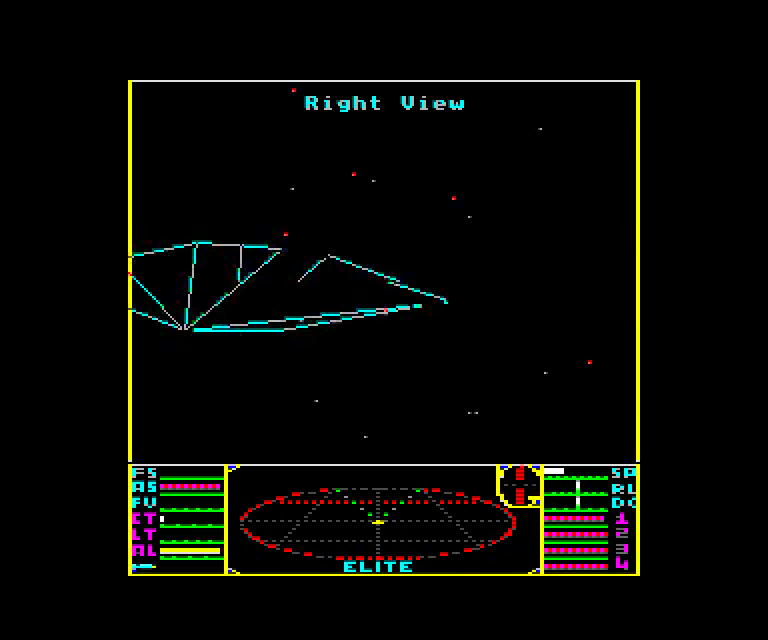
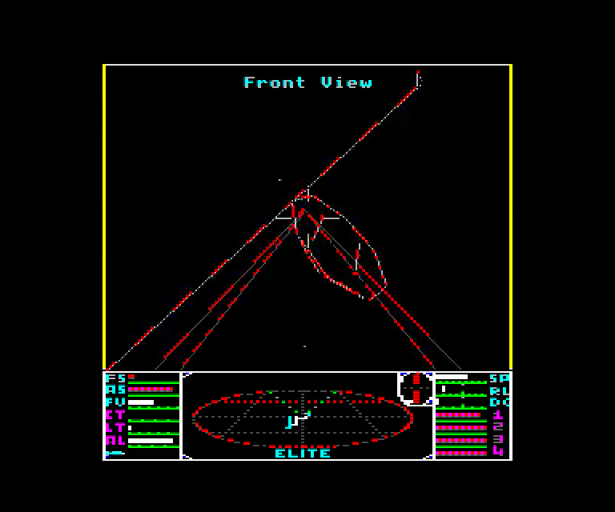
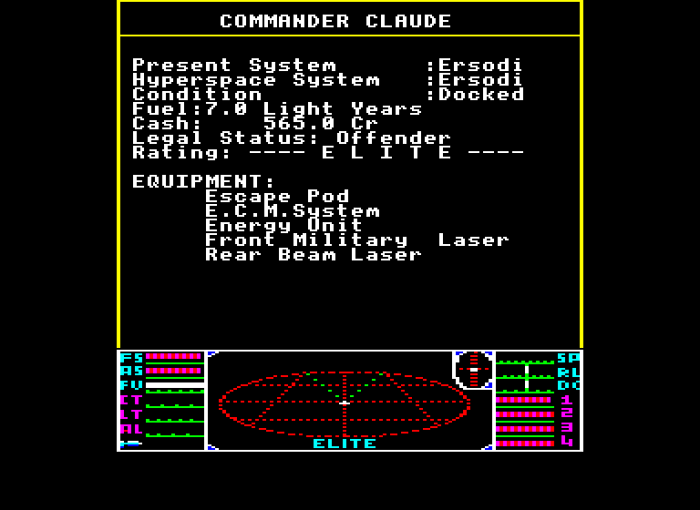
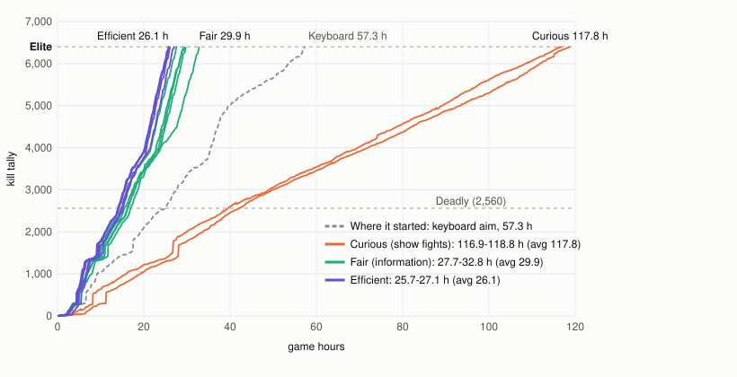
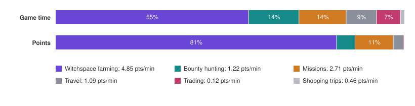
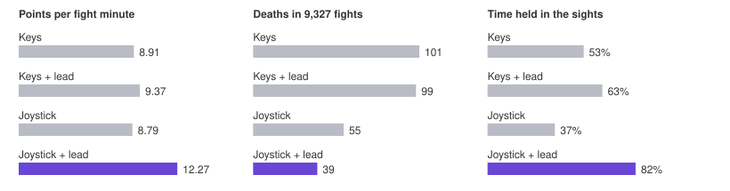

# Elite agent

A player for Acornsoft Elite (BBC Master, Mark Moxon's flicker-free build), written in pure C. It reads
the machine's RAM and plays only through the keyboard and the analogue joystick (Elite's own joystick
option). It's self-contained: no OS, no heap, no network, no model, just rules, about 100 KB of code
and under 30 KB of RAM compiled for the RP2350's Cortex-M33. It runs on that microcontroller, a Pimoroni
Presto, beside the BBC Master emulator, averaging about 2.4 ms of each 20 ms frame; the same code runs on a native
build of the emulator (Pi or Mac) for development.

It's also released as a plugin for [rp2350-bbc-micro](https://github.com/8bitkick/rp2350-bbc-micro)'s
plugin slot: `elite-agent.bin` on the [releases page](https://github.com/8bitkick/elite-agent/releases).

| | | |
|---|---|---|
|  |  |  |
| A flyby, watched from the side | Lasers on a Thargoid in witchspace | Elite |

## Modes

| Mode | What it does | Jameson to Elite |
|---|---|---|
| **Efficient** | straight for Elite; reads any RAM it needs, even bytes the screen never shows, like an enemy's energy ([`docs/IO.md`](docs/IO.md)) | **23.8 game hours** (22.6-24.1 on five careers, no deaths) |
| **Fair** | only what a player could see: the screen, scanner and dashboard as drawn, the game's rules, its own notes; no hidden RAM ([`docs/FAIR.md`](docs/FAIR.md)) | **29.8 game hours**, efficient + fair (29.0-30.7 on five careers, on an earlier build; every RAM read audited) |
| **Curious** | explores every galaxy, meets every ship type, both missions; fights for the camera: enemies close and big on screen, flybys watched from the side, strafing runs, Thargoid swarms, losses up to 5% accepted ([`docs/FIGHTING.md`](docs/FIGHTING.md)) | not tuned for time: its fights are for watching (Elite took 134.8 game hours on an earlier build, the column below) |

All modes save at each dock (about 4 seconds; on the Presto curious runs the save in turbo), so a death loses only the trip since. Times are game
hours on the native emulator at the real machine's speed.



**Careers in numbers** (the mean per career, Jameson to Elite; `tools/career_stats.py`):

| | Efficient (5) | Fair (5) | Curious (1, round 5) |
|---|---|---|---|
| Game hours to Elite | 23.8 | 29.8 | 134.8 |
| Star systems visited | 62 | 67 | 272 |
| Galaxies | 3 | 3 | 8 |
| Light years flown (dock to dock) | 630 | 677 | 3,109 |
| Docks | 348 | 366 | 1,049 |
| Fights | 2,074 | 2,521 | 5,523 |
| Kills | 5,458 | 5,587 | 12,705 |
| Witchspace sessions (Thargoids) | 190 | 198 | 66 |
| Deaths (reloaded) | 0 | 3 | 115 |
| Escape pods used | 0 | 0 | 0 |
| Most credits held | 30,911 Cr | 23,538 Cr | 18,743 Cr |

Fair counts more fights because a dot at the edge of range can turn out to be a trader once it's
drawn, ending a fight that hadn't started.

Curious mode's fights are for the camera, and it's tuned on how big the enemy is on screen and for how long: a ship
drawn 64 to 160 pixels counts a whole second, less as it gets smaller or too big to fit (`tools/show.py`'s BIG SHIPS).
Its steering in a fight is a camera operator's (`cplayer/cfly.c`): with the enemy in the picture the pitch eases on
and off and never flips for a small error, a roll is one deliberate move when the ship is out to the side, and a
speck far off is flown in a few big moves rather than re-aimed every frame; out of the picture it comes round as fast
as it can. Specks that are getting away are shot rather than chased. Efficient mode kills from as far out as it can.

**Where efficient's time goes** (seed 13): witchspace farming of Thargoids, by a forced mis-jump, is
55% of the time and 81% of the points, about 5 a game minute; bounty hunting at anarchies makes a
quarter of that. The early ranks take three hours, Deadly to Elite about 14. The two missions take 4
hours and pay for themselves: without them it reaches Elite 4.7 hours later.



**Why it's fast:**

- **Aim.** The joystick put at an exact position each frame, aiming 4.5 game loops ahead, and each
  new target reached in one planned roll-and-pitch motion simulated from Elite's own rotation maths.
  Over 9,327 recorded fights: 38% more points a fight minute than the keyboard, 39 deaths instead
  of 101, the target in the sights 82% of the time.
- **Thargoids.** Witchspace fights score about 30 points a fight minute, normal space about 12.
- **Cheap deaths.** With a save at every dock it can take risks a no-save player can't.
- **Docking.** A smooth line-up at full speed: about 17 s a dock faster than v0.3, over ~350 docks a
  career, and no more flying into the planet on the way.
- **No waiting about.** It fights pirates on the way in as far out as it engages in a hunt (ones
  hanging back used to block the in-system jump), and leaves witchspace after its last fight without
  recharging: 31.4 to 27.4 hours.
- **It never runs.** It fights every fight to the end: with a save at every dock a lost fight costs
  only the trip since, and breaking off cost more time than the deaths it saved (26.9 to 26.1 hours;
  over ten careers 26.9 to 26.2, deaths 14 to 8). Curious mode still breaks off, flying tail-first
  and shooting the nearest pursuer with the rear laser.
- **No wasted trips.** Routes avoid systems the chart cursor can't select; the escape pod waits
  until it's rich.



**Which Elites.** Mark Moxon's flicker-free SNG47 on the Master, Eben Upton's
[Solid Elite](https://github.com/ebenupton/solid-elite-bbc-master) on the Master (filled, sunlit ships;
the same game with its workspace and code moved), and Moxon's flicker-free disc version on the Model B.
The player finds which is loaded from signatures in RAM and reads each one's addresses from its own
table (`cplayer/elite_ver.c`). Solid Elite's renderer borrows some of zero page while it draws (energy
and the shields among it) and zeroes the view byte while it draws the mission briefing's ship; the player
reads both as the game has them. Run it with `DISC=` its disc (`5-compiled-game-discs/elite-master-sng47.ssd`
in its repository): six 5-hour efficient careers reached Dangerous, past the Constrictor mission.

**Docking** is at full speed, on the slot's centre. Elite's docking test checks only angles (the approach
within 26 deg of the slot's axis, the station's centre within 22 deg, the slot within 36.6 deg of level),
never speed, so with the angles well inside those and both shields at 160 or more it flies in at 40. It
lines up on the slot's axis by a vector field, as fixed-wing drones line up on a runway: far off the axis
it heads in at up to 60 deg, turning onto the axis as it closes, and from behind the station it first flies
a circle onto it, banked once and pitching round as a plane flies a steady turn, clear of the planet. On
the axis it rolls with the station to hold the slot level, and holds the slot's centre up to 6 deg above
or below the nose so the roll carries it across onto the nose (`cplayer/pilot.c`). Over 12 two-hour
careers: 81 s from the station's safe zone to docked (the median; 98 s on v0.3), entries within 21 of
the axis, half the stick reversals of v0.3. Its old line-up flew into the planet four times in five
careers to Elite; this one hasn't in ten.

## The player (`cplayer/`)

| File | What it does |
|---|---|
| `player.h` | the interface: read-only RAM in, held keys, taps and joystick values out, one call a frame |
| `agent.c` | the career: shopping, trading, bounty hunting, witchspace farming, missions, recovery |
| `combat.c` | fighting: threats, targets, aim, speed, fire, evasion, ECM, missiles, bomb, pod |
| `pilot.c` | steering, the run in to the station, docking (roll-matching the slot) |
| `flight.c` | launch, hyperspace, the chart cursor, witchspace exits and chains, galactic jumps |
| `docked.c` | the docked screens: market, equipment, saving, titles |
| `galaxy.c` | the galaxy, markets, trade plans and loops, routes, safe jump ranges |
| `ships.c` | the ships in the bubble, and the crosshair test |
| `drv.c`, `keyq.c` | coroutines over frames (`pt.h`), keys, the joystick, death detection |
| `state.h`, `elite_ram.h` | named views onto Elite's RAM (addresses from `elite/symbols.json`) |

Every helper is a protothread coroutine that runs a little each frame and keeps its state in a static
struct; one that fails sets `g_fail` and the career loop recovers.

## Running it headless

The emulator is [rp2350-bbc-micro](https://github.com/8bitkick/rp2350-bbc-micro)'s BBC Master core,
at a pinned commit. `scripts/fetch-emulator.sh` fetches it into `rp2350-bbc-micro/`, with the ROMs and
the Elite disc, which are in neither repository.

```sh
git clone https://github.com/8bitkick/elite-agent.git && cd elite-agent
scripts/fetch-emulator.sh                      # the emulator, the Master's ROMs and Elite
cplayer/build.sh                               # run_sim: a career (elsewhere than Linux: ELITE_EMU=its path)
cplayer/buildlab.sh                            # lab: the fight lab
cplayer/run_sim 2400 "" journal.jsonl          # a career, up to 2,400 game minutes; Elite in ~26 h
tests/career120.sh                             # the player's behaviour pinned: a 120-minute career's journal hash
```

It runs about 100 times faster than a real BBC Master, prints its log as it plays and writes a JSON
line per event (docks, fights, sessions, deaths, ranks) to the journal. Options, in the environment:

| Option | What it does |
|---|---|
| `SKEW=n` | start n frames late: a different career |
| `CURIOUS=1` | curious mode |
| `FAIR=1` | fair mode (`FAIRHANDS=1` adds limits on the stick and keys) |
| `STOPFAIL=1` | stop at the first death or restart |
| `SAVE=0` | never save (a death ends the career) |
| `FIGHTS=dir` | record each fight's starting snapshot, for the lab |
| `SHOTS=from-to:step` | PPM screenshots every `step` frames in that range |
| `LOAD=NAME` | load that commander from the disc when docked |
| `DISCDUMP=file.ssd` | write the disc, with the career's saves, at the end |

A black box is printed on every death. **The fight lab** replays recorded fights from their
snapshots, fighting each as the career would:

```sh
mkdir -p fights && FIGHTS=fights cplayer/run_sim 600 "" journal.jsonl
ls fights/*.fight > fights.lst && UNDAMPED=1 cplayer/lab fights.lst   # a line per fight
```

`tools/suite.py` runs sets of recorded fights in parallel per scenario (pirate pack sizes,
witchspace) with aim, targeting and death-cause measures, from `~/work/corpus` and `~/work/sets`;
`tools/compare.py` compares two runs fight by fight; `tools/career_summary.py` gives a line per
career; `tools/climb_chart.py` draws the chart above from career journals.

## On the Presto

The plugin: `presto/app/build.sh` (`--efficient` for efficient mode; curious by default; fair mode only with
`--fair`, its 17 KB of RAM left out otherwise) builds
`presto/app/build/elite-agent.bin` against the plugin interface in `presto/api/` (no Pico SDK but its
maths). Install it on a Presto running rp2350-bbc-micro from the web panel's Plugin section, or with
its `tools/presto.py app install elite-agent.bin`. A tag `v*` releases it (`.github/workflows/release.yml`).
The agent starts a little after boot.

Or built into the firmware: `presto/build.sh` (`--curious` for curious mode, `--fair` as above, the Pico SDK and
`scripts/fetch-emulator.sh` first) builds `presto/build/presto_master.uf2`. Hold BOOT, tap RESET,
copy it to the RP2350 drive.

The web panel (http://beeb.local/) shows the rank and progress, credits, where it is and what it's
doing, play time, kills, deaths and pods, its latest status lines, and buttons to start or stop it
and switch modes. Over USB: `!agent start|stop`, `!agent mode efficient|curious`, `!agent fair
on|off|hands`, `!agent name <NAME>`, `!agent load <NAME>` (when next docked), `!agent status`, `!agent log
0|1|2`. Saves survive a power-off (the firmware keeps a save disc in flash).

`presto/elite_presto.c` is the Presto side, `presto/elite_splash.c` the loading screen
(`tools/make_splash.py`). `docs/` explains the game from its source: economy, flight and combat,
game flow.
