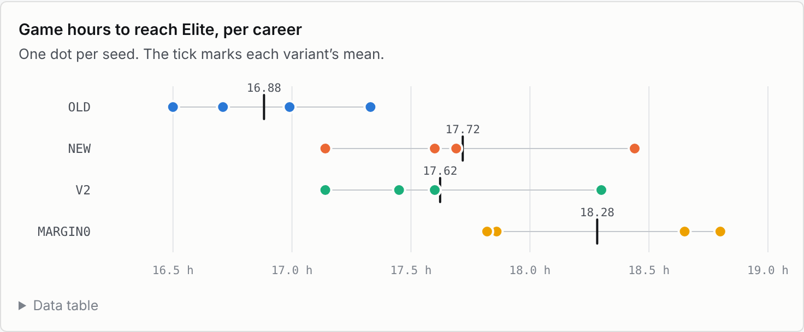
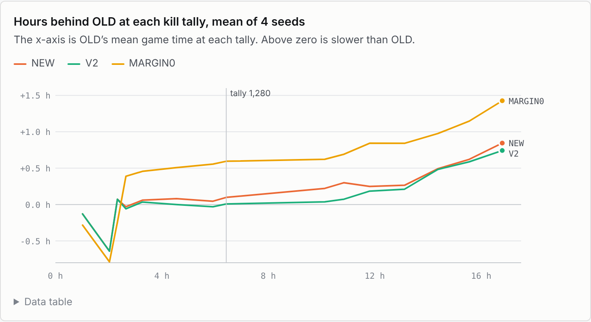
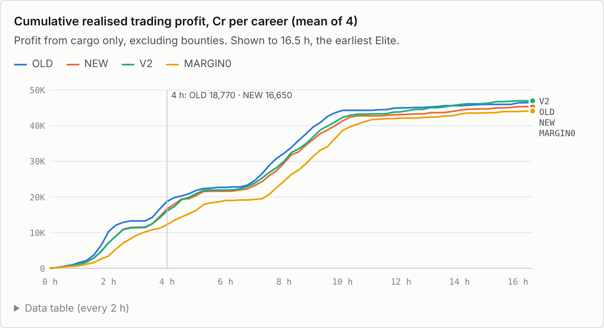
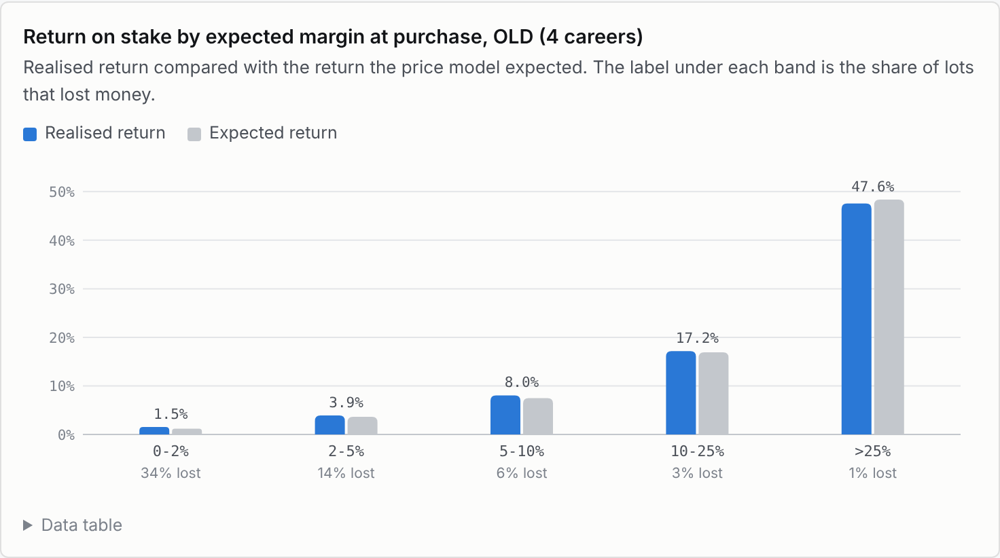
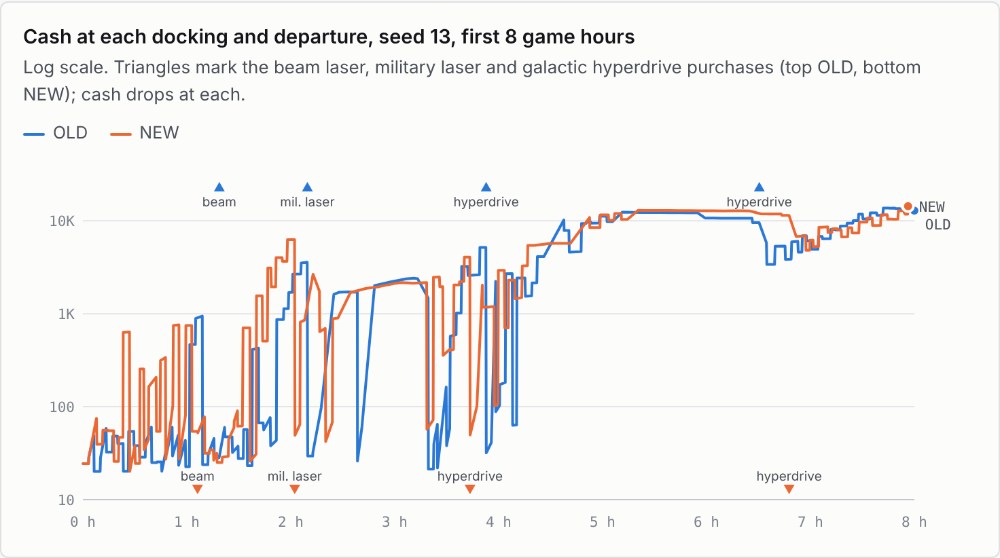
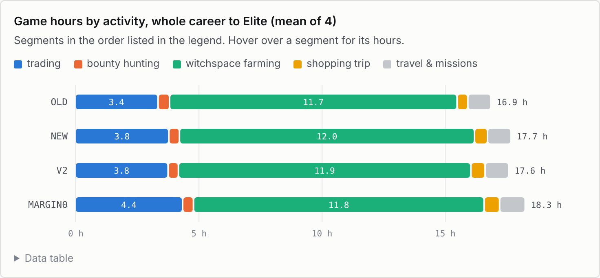
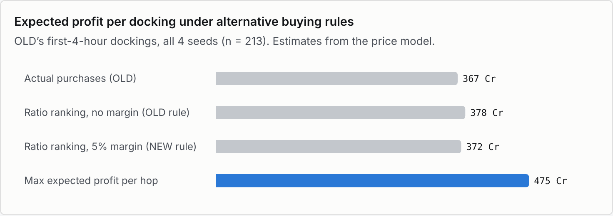

# Trading review: why the sloppy trader reached Elite first

Four trading rules, each played from the same four starts (Fair mode, seeds 0, 13, 21 and 101), compared by game hours
to the rank of Elite (kill tally 6,400) and by the money they made. 16 careers, analysed from their journals and logs;
1 game hour = 180,000 frames; Cr = credits.

## Summary

The original rules (OLD) took **16.88 game hours** on average to reach Elite. The current rules (NEW) took **17.72 h**,
and two other rewrites 17.62 h (V2) and 18.28 h (MARGIN0). OLD did trade better where trading counts, in the first
four game hours: **18,770 Cr** realised profit per career against 16,650 Cr for NEW. Its thin-margin "filler" cargo
made money: 240,800 Cr staked across four careers returned **+6,740 Cr (2.8%)**, a little above the +6,020 Cr the price
model expected. But that edge bought almost no time: when OLD reached a kill tally of 1,280 (about 6.4 h), NEW was only
0.10 h behind. Most of the gap opened later, in witchspace farming, where trading plays almost no part. With four
careers per rule, the 0.84 h difference is not statistically secure (paired t-test, p = 0.14).

| | OLD | NEW | V2 | MARGIN0 |
|---|---:|---:|---:|---:|
| Game hours to Elite (mean of 4) | **16.88** | 17.72 | 17.62 | 18.28 |
| Seeds 0 / 13 / 21 / 101 | 16.50 / 16.71 / 17.33 / 16.99 | 18.44 / 17.69 / 17.60 / 17.14 | 18.30 / 17.45 / 17.60 / 17.14 | 18.65 / 18.80 / 17.86 / 17.82 |
| Trading profit, first 4 h (Cr per career) | **18,770** | 16,650 | 16,050 | 12,230 |
| Buy-backs per career | 56 | 0 | 0 | 0–2 |

## The rules

| Rule | What it does |
|---|---|
| **OLD** | Buys anything expected to gain more than 0.1 Cr a unit, best gain/price ratio first. Sells everything at each dock (so sometimes sells an item and buys it straight back). Trades instead of farming only while saving for a purchase of 5,000 Cr or more. |
| **NEW** | Live now (commit fe25210). Needs a 5% expected margin. Keeps cargo the next hop would buy. Trades whenever any listed purchase is unaffordable. |
| **V2** | NEW, but trades only while saving for a big (≥ 5,000 Cr) item. Seeds 21 and 101 played out identically to NEW. |
| **MARGIN0** | NEW with no minimum margin. |

## 1. Where the time went

The four starts differ more than the rules do. OLD was fastest on every seed, by 0.15 h to 1.94 h; two seeds (0 and
13) account for most of the gap.

Matching each career against OLD on the same seed shows when the gap opens. Up to a kill tally of 1,280, where the
second galactic hyperdrive and the missions open up (about 6.4 h for OLD), NEW and V2 were within 0.1 h of OLD. The
trading phase is over by then. NEW lost 0.75 of its 0.85 h deficit after that point, in the witchspace phase.

Late-game witchspace sessions (after 9.5 h) scored 11.9 kill points a minute for OLD against 11.2 for NEW, and NEW cut
sessions short ("Losing to the Thargoids: hyperspace out") 4.1 times a session against 2.9. The logs do not show why:
equipment, cash (17,500–21,500 Cr on average) and deaths (3 per rule) were all similar. Once two careers make one
different decision their random draws diverge, so part of this may be luck. Pooled over about 200 sessions per rule
the difference looks real (Welch p ≈ 0.04), but sessions within one career are not independent.

## 2. Trading profit

Realised profit is the sale proceeds minus the purchase cost of each lot. Over a whole career every rule made about
the same, 46,000–47,500 Cr; the difference is in timing. OLD made its money earlier, when credits buy the equipment
that speeds everything after.

The filler, cargo whose expected gain was under 5% of its price, was profitable in practice. It was 90% gold and
platinum, which are traded by the kilogram and take no hold space, so it put cash to work that would otherwise have
sat idle. Realised returns tracked the price model closely in every band. Low-margin lots lost money more often (22%
of them), but each loss was small: the worst a 2% item can do is lose a few percent of its stake.

## 3. Cash and purchases

Keeping cargo in the hold avoids the buy-backs, but the agent does not count that cargo as money: its purchase and
"saving up" decisions look at cash alone. On NEW's saving trips the hold carried 2,090 Cr of cargo on average (at
cost). At 65 of 119 such dockings in the first five hours, cash plus cargo would already have paid for the item it was
saving for (MARGIN0 75 of 140, V2 27 of 128, OLD 5 of 35). Equipment dates still came out close: on seed 13, NEW
fitted its beam laser, military laser and first hyperdrive earlier than OLD.

## 4. Time allocation

Each stretch of game time between two of the agent's trip decisions is labelled by its reason: trading, bounty
hunting, witchspace farming, shopping, or travel and missions. Witchspace farming takes about 70% of every career. The
any-purchase saving rule moved about 0.35 h of the first four hours from early witchspace farming into trading (OLD
3.3 h of trading, NEW 3.7 h), without costing NEW much tally by the 4-hour mark.

## 5. A better trading rule

OLD's own 213 cargo decisions from the first four hours were replayed with the same prices, stock, cash and hold
space, and alternative buying rules compared by the profit the price model expects for each hop. This compares rules
one docking at a time; it does not simulate whole careers.

Ranking by gain/price ratio is the real weakness. When the hold fills before the cash runs out, a cheap item with a
high ratio (food at 3 Cr) crowds out computers that make far more per tonne. Choosing the cargo that maximises expected
profit for the hop, within both the hold and the cash limits, raises expected profit per docking by about a quarter.
The 5% margin, by contrast, changes it by under 2%.

### Recommendations

1. **Maximise expected profit per hop, not the ratio.** A 17-item knapsack with two limits (tonnes and credits),
   small enough to solve exactly at each dock. Expected effect: 378 → 475 Cr per docking (+26%, an estimate), about
   4,700 Cr more per career over the first four hours. At OLD's trading rate (about 5,700 Cr per trading hour) that
   could cut up to 0.8 h of early trading if equipment is cash-bound; probably less, as kill tally also gates the
   missions.
2. **Drop the minimum margin, or set it near zero.** Buying and selling at the same price costs nothing, and the
   sub-5% filler returned 2.8% against 2.5% expected. A margin makes sense only when a purchase is so nearly
   affordable that a loss would delay it. Expected effect: under +2% of trading profit (estimate).
3. **Keep the no-buy-back fix, but count cargo as cash.** The shop and the saving check should value the hold at this
   station's price, and sell what's needed to complete a purchase. That removes about 56 pointless sell-and-rebuy
   cycles per career without hiding about 2,000 Cr of capital from purchase decisions.
4. **Save only for big items.** V2 (big items only) and NEW (any item) were nearly identical, 17.62 h against 17.72 h,
   and two of the four seeds played out exactly the same. The broader rule adds trips without a measurable benefit.
5. **Test the late game separately.** Most of the time difference came from witchspace session results, not trading.
   Restarting OLD and NEW from a shared save at the start of witchspace farming would show whether that difference is
   caused by the code or by chance.

## Method and caveats

- **Sample.** 4 careers per rule (seeds 0, 13, 21, 101), Fair mode, all run to Elite. The seed-to-seed spread
  (0.4–0.5 h standard deviation) is about as large as the effect. Paired t-tests against OLD on hours to Elite: NEW
  p = 0.14, V2 p = 0.14, MARGIN0 p = 0.045 (3 degrees of freedom). The OLD careers for seeds 13 and 101 come from an
  earlier batch of runs than the other two.
- **Trading ledger.** Built from the log's "Bought" and "Sold" lines with first-in-first-out matching. The station's
  random price byte was solved from each sale total and the purchase prices, using the game's price table. Prices
  could not be pinned down for 3–4% of sold lots, which are left out; scooped cargo is left out.
- **Expected margin.** The mean price of the item over all 256 values of the random byte at the planned destination's
  economy, minus the purchase price, as the agent computes it.
- **Time allocation.** Time from each trip event in the journal to the next, labelled by the event's reason and whether
  a hunting or witchspace session followed. Missions and galactic jumps count as travel.
- **Counterfactual.** The agent's own ranking rule reimplemented in Python reproduces 89% of OLD's actual purchases
  (the misses are mostly dockings where the price byte is ambiguous). The profit-optimal rule was solved as an integer
  program. The figures are expected profits from the price model, not results played out in the game.
