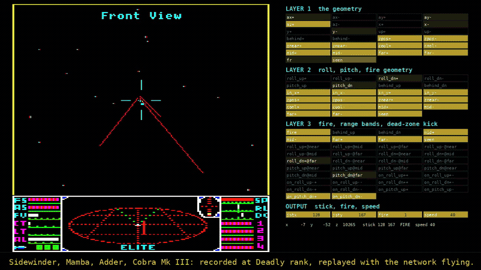

# Fair mode's pilot: an AI-authored custom model



Fair mode (`FAIR=1`) flies its dogfights with a small neural network, and the player sees only what a human could
(fair mode, [docs/FAIR.md](../docs/FAIR.md)): the screen, the scanner and the dashboard as drawn, no hidden RAM.
It **outscores the C rules it replaced: 2.8% more points a fight minute on 450 held-out fights** (90% interval
0.6-5.2%), ahead in every kind of fight. In careers to Elite it was ahead on all three seeds before the chain-farm
strategy was merged (27.2 game hours against 27.8), and on the current build is level on two (16.5 against 16.4).

The network is **2,256 weights (8.8 KB), run by a forward pass of about 60 lines of plain C**
([cplayer/wsp_pilot.c](../cplayer/wsp_pilot.c)), with no ML library, like the rest of the agent. Its weights were
**authored directly by an AI**, unit by unit, every one named, then **tuned by evolution** in the fight lab. No gradient ever
touched them. It follows MIT CSAIL's
[Sparks of Weight-Space Programming](https://rikiyat.github.io/blog/weight-space-programming/) (2 Nov 2026):
a frontier LLM writing network weights directly, as a program, rather than training them.

| | |
|---|---|
| **Switch** | on in fair mode (`FAIR=1`); `WSP=0` puts the C rules back for comparisons, `WSP=1` flies the network in Optimal mode too. Optimal mode is unchanged: a career's journal is byte-identical without it |
| **What it flies** | the stick, the laser and the throttle in a fight. Target choice, missiles, ECM, evasion, docking, trading and the career stay the C agent's |
| **One part it borrows** | in witchspace, the C's acquisition planner (pilot.c `plan_stick`) turns onto each new Thargoid (below). `WSPPLAN=0` turns it off |
| **Size** | 23 inputs, 4 hidden layers (30, 26, 16, 14), 4 outputs: 2,256 weights, 187 of them non-zero |

## The results

### In the fight lab

Each of 450 fights recorded from two C careers (150 witchspace swarms, 150 pirate packs, 150 fights with one or
two ships), none used in tuning, flown by each pilot from the identical snapshot, each in a fresh process. Points
a fight minute (the tally is the rank: points per kill by ship type), and the ratio to the C rules in the same mode,
with a 90% paired-bootstrap interval:

| | Optimal | | Fair | |
|---|---:|---|---:|---|
| C rules | 20.32 | | 18.15 | |
| network, as written (the C's numbers) | 18.77 | 0.924 (0.901-0.948) | | |
| network, evolved | 19.76 | 0.972 (0.949-0.997) | 17.62 | 0.971 (0.945-0.997) |
| **network + the planner in witchspace (fair mode's pilot)** | **20.03** | **0.986 (0.966-1.006)** | **18.66** | **1.028 (1.006-1.052)** |

By kind, fair mode: witchspace 20.50 against 20.06 (1.022), pirate packs 12.29 against 11.74 (1.047), small
fights 7.34 against 6.97 (1.052). No deaths in any of the 450, for either pilot.

### Careers to Elite, fair mode

Game hours when the tally reached 6,400, both pilots on the same seeds (`SKEW`) and build. On the current build,
with chain-farm's strategy of farming where forced mis-jumps chain (the journals are in [../docs/careers](../docs/careers)
and [careers/](careers)):

| seed | network | C rules (`WSP=0`) | |
|---|---:|---:|---|
| 13 | 16.5 | 17.1 | network 0.6 h ahead |
| 101 | 16.5 | 15.6 | C 0.8 h ahead |
| **mean** | **16.5** | **16.4** | level |

Before chain-farm was merged (the same network; the journals in [careers/](careers)):

| seed | network | C rules | |
|---|---:|---:|---|
| 0 | 27.2 | 27.9 | network 0.7 h ahead |
| 13 | 28.4 | 28.5 | network 0.1 h ahead |
| 21 | 26.0 | 26.9 | network 0.9 h ahead |
| **mean** | **27.2** | **27.8** | 2.0% faster |

A career is one path, and a seed moves it by more than either pilot does (the C rules' two chain-farm careers are
1.5 hours apart). Five careers say the network is at least the C rules' equal over a whole career; the lab's 450
paired fights are what say it's better in a fight.

## Why fair mode

Optimal mode reads exact positions, headings and energies from RAM; fair mode gets them from what's drawn, through
a tracker (fair.c), and every pilot loses about 11% to that (both: 0.893 and 0.892 of their Optimal selves). The C rules steer with the tracker's estimates as if they were exact. The network is the better tracker of a target
(below) and holds its lead over the C in normal space when the information gets worse, where the C's lead in
witchspace comes from a planner that works equally well either way. So in fair mode the network's strengths count
for more, and with the planner for the swarms it comes out ahead.

## How it was built

**v1** ([v1/](v1)): 2,053 weights written to steer on lateral offsets in ship space, about 72% of the C's points
a minute on the hard fights. Its two in-game fixes (a kick past the joystick's dead zone, gains banded by range)
were weight edits found by reading the lab's numbers.

**v2, written** ([elite_wsp/author.py](elite_wsp/author.py)): the C rules' steering law (pilot.c `steer`) and
throttle, re-expressed for a ReLU network over sightline senses: how far off the nose and at what clock position,
how fast the target moves across the sky, how big it looks, the range. The network has no atan2, so the senses do
the trigonometry ([elite_wsp/features.py](elite_wsp/features.py)) and the network every decision:

- the lead aim point: the sightline plus `lead` loops of its motion (layer 1)
- roll it into the vertical plane: min(|aim x| / `roll_ramp`, `roll_cap` |clock x|), on the side chosen with
  `hyst` hysteresis from the stick (layers 2-4)
- pitch onto it, easing off while the roll error is large (the cone `pitch_cone`), hard when far off the nose
- fire: an AND of six booleans, the nose inside `fire_r` hit radii among them
- the throttle: stop to turn past `turn_off`, then by range bands

Every constant is a named parameter, and the C's own tuned numbers are the defaults: as written, 92.4% of the C.

**v2, evolved** ([evolve/es.py](evolve/es.py)): CMA-ES over the 21 named parameters, scored in the fight lab on
training fights only: 97.2%. What evolution changed reads as a story: a snappier roll (gain +22%, the ramp
halved), harder pitch (+24%), less lead (3.7 loops, not 4.5), and flying on while up to 20 degrees off the nose,
not 15. It's [evolve/es_params.json](evolve/es_params.json); the weights are [elite_pilot.npz](elite_pilot.npz)
(names and notes) and [elite_pilot.wsp](elite_pilot.wsp).

**Where the last points are.** The lab's time-to-kill split, per kill in witchspace: both pilots take the same time
to slew onto a target (1.42 s), the same in the sights (0.46 s), the same between targets; the network loses it in
one phase, the capture from 10 degrees into the sights (0.58 s against 0.47). There the C flies a planner that
searches Elite's exact rotation, including the gaps in the stick's rates (pitch has no rate 2, roll none from 4 to 7).
The network is the better tracker (hold 83% against 80%, aim 1.2 degrees off against 1.9) and the slower acquirer. In
a swarm, a fight is forty acquisitions, so the planner flies those in witchspace and the network everything else.

**Four inputs about the senses' confidence** (fair.c's tracker): whether the heading was seen on a wireframe or
guessed from motion, how stale the sighting is, the range's and the motion's uncertainty. In Optimal mode they
read "seen, fresh, exact". The written law doesn't use them yet: gating the lead and the fire cone by them was
tried and cost points. They're there for what comes next.

## What didn't work

All measured on held-out fights, none kept:

- **PPO** on a learned residual over the written network: its improvements were inside the noise of 180-fight
  rollouts, and val wandered 20.0-20.4 against the evolved network's 20.3.
- **Distilling the planner** (DAgger, a regression on its roll and pitch): the planner's choices are discrete and
  bang-bang, and a regression averages them away. A gated residual kept the tracking exact but changed nothing.
- **Dithering the stick** to give the rates Elite's stick map lacks on average: Elite reads the stick once a game
  loop (two or three frames), so frame-by-frame dithering aliased into noise (-2.6%).
- **Confidence gates** (less lead when the heading is guessed, a smaller fire cone) and a **nose hold** (no roll
  near the nose): all cost points, in both modes.
- **Fair-mode tracker settings** (memory, continuity, speed filter): in the noise, or not smooth in the setting.

## Measuring it honestly

Two things in the lab bit, and are fixed in [evolve/lab.py](evolve/lab.py):

- **State carried between fights.** The lab runs a list of fights in one process, and the player keeps state from
  one fight to the next (target memory, timers, the planner). A fight's result depended on the fights before it:
  the C rules' val score moved from 18.9 to 20.8 with how the list was split. Every fight now runs in a fresh
  process (the emulator starts in a few milliseconds).
- **Small sets.** On 40 fights the same pilot's score swings about 3%, as large as the effects being chased. The
  results here are on 450 fights with paired intervals; val (40) was only for watching evolution.

(The repo's pinned test, tests/career120.sh, fails on clean `main` in this environment too: its hash was pinned on
another machine. `WSP` off, this branch writes the identical journal to `main`'s.)

## Running it

```
cplayer/buildlab.sh && cplayer/build.sh
FAIR=1 SKEW=13 cplayer/run_sim 3000 "" journal.jsonl           # a fair career, flown by the 8 KB AI pilot model
python3 -m elite_wsp.author                                     # write the weights from author.py's defaults
python3 -m elite_wsp.inspect elite_pilot.npz                    # read them back, unit by unit
python3 tests/test_pilot.py                                      # the weights against their spec, C against numpy
cd evolve && python3 -c "import lab; print(lab.fmt(lab.score(lab.run(lab.read_set('big'), wsp='written_es14.wsp', extra_env={'FAIR':'1'})[0], by_kind=True)))"
```

The fight sets in [evolve/sets/](evolve/sets) name recorded fights: `FIGHTS=fights2 run_sim 720` and
`FIGHTS=fights3 run_sim 2400` (SKEW 0, the C rules) record them. `train` (180) was the only set evolution saw; `big`
(450) and `test` (60) are held out.

| Switch | |
|---|---|
| `WSP=0` / `WSP=1` | the C rules in fair mode / the network in Optimal mode (the default: the network in fair mode only) |
| `WSPPLAN=0/1/2` | the C's planner for acquisition: never, always, in witchspace (the default) |
| `WSPW=file.wsp` | other weights at run time (evolution's candidates) |
| `WSPLOG=file` | each decision: the senses, the action, the score |
| `WSPN`, `WSPR`, `WSPTEACH` | exploration noise, a learned residual, the planner's labels (ppo.py, distil.py) |

## Files

```
elite_wsp/features.py   the senses: the target's sightline, as cplayer/wsp_pilot.c computes it
elite_wsp/layers.py     writing a ReLU layer unit by unit, by name
elite_wsp/author.py     the network, written: every unit named and annotated, every constant a parameter
elite_wsp/reference.py  the same law as plain arithmetic, the spec the tests hold the weights to
elite_wsp/export.py     .npz (with names), .wsp (run time), cplayer/pilot_weights.h (compiled in)
evolve/lab.py           the fight lab in parallel, one process a fight; scores and paired comparisons
evolve/es.py            CMA-ES over the named parameters
evolve/ppo.py           PPO on a residual (tried; see above)
evolve/distil.py        DAgger on the planner (tried; see above)
careers/                the fair careers' journals, both pilots
v1/                     the first version: its lab results, the web demo and the film scripts
ROADMAP.md              what's next
```
